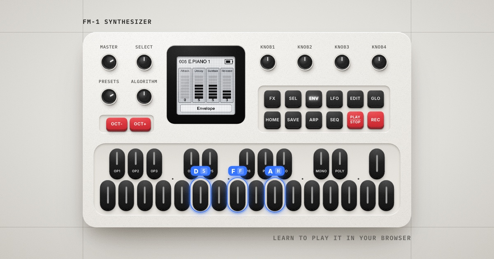

# FM-1 · learn to play it

A web replica of the **M-VAVE FM-1** synthesizer, made to learn the instrument by playing it.

**Live:** https://fm1-sigma.vercel.app



## What it does

- **Play** a 6-operator FM synth (DX7-style) with the FM-1's knobs, buttons, screen and 27 keys. Use the mouse, your computer keyboard (`A`–`;` white keys, `W E T…` black keys, `Z`/`X` octave) or a MIDI keyboard.
- **Learn** with guided lessons: a tour of every control, and *Warm Snow*, an original piece in the style of Aphex Twin. A blue ring shows what to press next.
- **Import a MIDI file** and turn it into your own step-by-step lesson.
- **Export** what you make: record a WAV with effects, or download your sound as a DX7 `.syx` bank for Dexed, a DX7 or the real FM-1.
- **Try community firmwares** (sloopDX, Frodhes, X0X, CHOPPAH and more) running for real inside the same device.

## Run it

```bash
npm install
npm run dev
```

`npm run build` makes the production build in `dist/`. Pushing to `main` deploys to Vercel.

To regenerate the share image (`public/og.jpg`) after changing `tools/og.html`, start the dev server on port 3500 and run `npm run og` (macOS + Google Chrome).

## Stack

Vite, React, TypeScript and Zustand. The FM engine and the WAV recorder run as AudioWorklets; there are no samples.

## Credits

- Community firmwares run on **[fm1-emu](https://github.com/joakimeriksson/fm1-emu)** by Joakim Eriksson (MIT), vendored in `public/emu/` with its license. Each firmware is downloaded from its author's page or [The Firmware Hub](https://thefirmwarehub.com/).
- FM-1 is a product of M-VAVE. This is an unofficial fan project for learning, not affiliated with M-VAVE.
